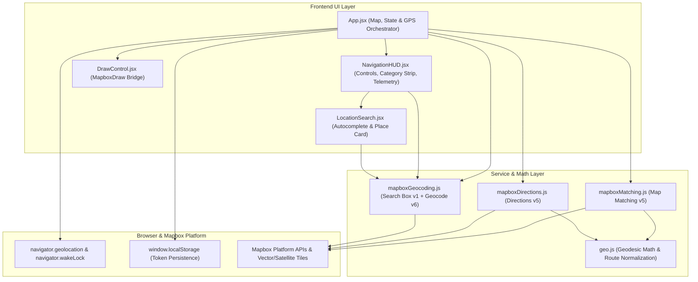

# Custom GPS Navigator (`custom-gps-map`) — Design & Features Specification

> **Document Scope:** Complete product, UI/UX design, technical architecture, data flow, and API specification for the `custom-gps-map` Progressive Web App located in [`custom-gps-map`](file:///d:/Main%20Downloads/TakeurRoute/custom-gps-map/package.json).

---

## 1. Product Overview

**Custom GPS Navigator** (`NavApp`) is a mobile-first Progressive Web App designed for drawing custom road bypass routes, discovering local stores and city points of interest (POIs), and executing live turn-by-turn GPS navigation over satellite, night, and day maps.

### Core Objectives
- **Custom Bypass Routing:** Let users sketch freehand multi-point lines directly on the map and snap them onto drivable roads (`driving`, `cycling`, `walking`) rather than accepting only standard shortest-path directions.
- **Satellite-First City Visibility:** Default to **Mapbox Standard Satellite** (`mapbox://styles/mapbox/standard-satellite`) with 3D context, road names, place labels, transit stations, and POIs visible immediately on startup.
- **Store & Place Discovery + Route Editing:** Enable autocomplete search and one-tap local category browsing (**Stores**, **Grocery**, **Food**, **Cafes**, **Fuel**, **Medical**, **ATMs**, **Hotels**) with options to create a new route, extend the tail, replace the destination, or insert an intermediate stop.
- **Live Turn-by-Turn GPS Guidance:** Continuously snap user movement to the route polyline, track remaining distance and ETA, trigger off-route warnings, and support hands-on 3D heading-up navigation with mobile screen wake lock.

---

## 2. Technology Stack & Dependencies

| Layer | Technology | Version | Purpose |
| :--- | :--- | :--- | :--- |
| **UI Framework** | React (`react`, `react-dom`) | `^19.3.1` | Component state, hooks, portals |
| **Build Tool** | Vite (`vite`, `@vitejs/plugin-react`) | `^8.3.6` | ESM dev server & production bundling |
| **Styling** | Tailwind CSS (`tailwindcss`, `@tailwindcss/vite`) | `^4.3.5` | Utility-first responsive HUD styling |
| **Mapping Engine** | `mapbox-gl` + `react-map-gl` (`react-map-gl/mapbox`) | `^3.34.2` / `^8.1.3` | WebGL map, Standard Satellite styles, markers, GeoJSON layers |
| **Route Drawing** | `@mapbox/mapbox-gl-draw` | `^1.5.2` | Freehand `draw_line_string` and `direct_select` vertex editing |
| **PWA Runtime** | `vite-plugin-pwa` | `^2.0.0` | Auto-updating Workbox service worker & web manifest |
| **Linting** | ESLint (`eslint`, `eslint-plugin-react-hooks`, `eslint-plugin-react-refresh`) | `^10.14.0` | Static checks & React Hooks v7 rules |

---

## 3. System Architecture



### Module Responsibilities
- [`src/App.jsx`](file:///d:/Main%20Downloads/TakeurRoute/custom-gps-map/src/App.jsx#L1-L1081): Owns map lifecycle, theme switching, geolocation subscription, wake-lock lifecycle, route state (`rawCoordinates`, `snappedRoute`, `routeSourceMode`), POI discovery markers, token modal, and HUD callbacks.
- [`src/components/DrawControl.jsx`](file:///d:/Main%20Downloads/TakeurRoute/custom-gps-map/src/components/DrawControl.jsx#L1-L222): Wraps `@mapbox/mapbox-gl-draw` using `useControl`, applies dark-friendly [`DRAW_STYLES`](file:///d:/Main%20Downloads/TakeurRoute/custom-gps-map/src/components/DrawControl.jsx#L6-L103), keeps event handlers fresh, and exposes imperative methods (`startLineDrawing`, `finishDrawing`, `clearAll`, `setLineCoordinates`, `editCurrentLine`, `deleteFeatures`, `getAll`, `getMode`).
- [`src/components/NavigationHUD.jsx`](file:///d:/Main%20Downloads/TakeurRoute/custom-gps-map/src/components/NavigationHUD.jsx#L1-L526): Renders the top search/category/maneuver stack, right-side quick controls, and bottom telemetry/action sheet.
- [`src/components/LocationSearch.jsx`](file:///d:/Main%20Downloads/TakeurRoute/custom-gps-map/src/components/LocationSearch.jsx#L1-L400): Handles debounced Search Box suggestions, Enter-key forward lookup, `/retrieve` coordinate resolution, distance computation, and route-modification buttons.
- [`src/services/mapboxMatching.js`](file:///d:/Main%20Downloads/TakeurRoute/custom-gps-map/src/services/mapboxMatching.js#L1-L88): Interfaces with Mapbox Map Matching API v5.
- [`src/services/mapboxDirections.js`](file:///d:/Main%20Downloads/TakeurRoute/custom-gps-map/src/services/mapboxDirections.js#L1-L55): Interfaces with Mapbox Directions API v5.
- [`src/services/mapboxGeocoding.js`](file:///d:/Main%20Downloads/TakeurRoute/custom-gps-map/src/services/mapboxGeocoding.js#L1-L281): Interfaces with Mapbox Search Box API v1 (`/suggest`, `/retrieve`, `/forward`, `/category`) plus Geocoding API v6 fallback.
- [`src/utils/geo.js`](file:///d:/Main%20Downloads/TakeurRoute/custom-gps-map/src/utils/geo.js#L1-L295): Implements geodesic calculations, polyline projection, step progression, bounds computation, accuracy polygon generation, formatting, and unified route normalization.

---

## 4. Visual & UI Design Specification

### 4.1 Viewport & Mobile Ergonomics
- Full-bleed viewport (`h-dvh w-screen overflow-hidden`) anchored on background `#090d16` with `overscroll-behavior: none` and disabled mobile tap highlight ([`src/index.css`](file:///d:/Main%20Downloads/TakeurRoute/custom-gps-map/src/index.css#L3-L16)).
- [`index.html`](file:///d:/Main%20Downloads/TakeurRoute/custom-gps-map/index.html#L6-L13) locks mobile pinch-scaling (`user-scalable=no, viewport-fit=cover`) and enables iOS standalone chrome (`apple-mobile-web-app-capable`, `black-translucent` status bar).
- Interactive HUD controls use frosted dark translucency (`bg-slate-950/90` with `backdrop-blur-md`) and border contrast (`border-slate-700/70`) so overlays stay legible over bright satellite imagery, night maps, or day maps.
- Standard `44px` (`h-11 w-11`) touch targets on right-side buttons and `38px` (`width: 38px; height: 38px`) inverted dark controls on the top-left Mapbox Draw group ([`src/index.css`](file:///d:/Main%20Downloads/TakeurRoute/custom-gps-map/src/index.css#L19-L45)).

### 4.2 Color Palette & Map Visual Hierarchy

| Visual Element | Hex / Tailwind Token | Layer / Purpose |
| :--- | :--- | :--- |
| **App Canvas / HUD Ground** | `#090d16` / `bg-slate-950/90` | Dark-mode base & frosted overlay panels |
| **Remaining Snapped Route** | `#2dd4bf` (Teal 400) on `#042f2e` casing | `10px` casing + `6px` core (`snapped-route-casing`, `snapped-route-remaining`) |
| **Traveled Route Portion** | `#64748b` (Slate 500, `0.75` opacity) | `5px` dimmed segment behind user's projected position |
| **Freehand Draft / Active Edit** | `#f59e0b` dashed / `#fbbf24` active / `#38bdf8` midpoints | `@mapbox/mapbox-gl-draw` styling (`gl-draw-*`) |
| **Route Endpoints** | `#34d399` (Start) / `#f43f5e` (End) | White-bordered `16px` circle markers |
| **Selected Location Pin** | `#8b5cf6` (`bg-violet-500` with violet glow) | Highlighted destination/search pin (`zIndex: 15`) |
| **Live GPS Puck & Accuracy Halo** | `#2dd4bf` arrow inside `#0f172a` ring + `0.14` fill | Directional heading marker (`zIndex: 20`) + `gps-accuracy-fill` |

### 4.3 Map Styles & Standard Satellite Integration
Configured in [`MAP_STYLES`](file:///d:/Main%20Downloads/TakeurRoute/custom-gps-map/src/App.jsx#L25-L43):
1. **`satellite` (Default):** `mapbox://styles/mapbox/standard-satellite`
   - Passes [`STANDARD_SATELLITE_CONFIG`](file:///d:/Main%20Downloads/TakeurRoute/custom-gps-map/src/App.jsx#L33-L43) enabling:
     - `showPointOfInterestLabels: true`
     - `showPlaceLabels: true`
     - `showRoadLabels: true`
     - `showTransitLabels: true`
     - `showRoadsAndTransit: true`
     - `showPedestrianRoads: true`
     - `lightPreset: 'day'`
   - Re-applies `map.setConfigProperty('basemap', ...)` on every `style.load` event via [`handleMapLoad`](file:///d:/Main%20Downloads/TakeurRoute/custom-gps-map/src/App.jsx#L223-L237) and theme effect so cycling back to Satellite preserves all labels.
   - Uses `styleDiffing={false}` on `<Map>` for clean transitions between Standard and Classic styles, and assigns Standard style slots (`slot: 'bottom'` for GPS accuracy polygon, `slot: 'middle'` for route lines).
2. **`night`:** `mapbox://styles/mapbox/navigation-night-v1`
3. **`day`:** `mapbox://styles/mapbox/navigation-day-v1`

### 4.4 HUD Screen Regions
1. **Top-Left Control Slot:** `DrawControl` (`line_string` button and `trash` button).
2. **Top Stack (`ml-12` offset to clear `DrawControl`):**
   - `LocationSearch` bar + autocomplete dropdown + Selected Location action card.
   - Scrollable POI Category chip bar + conditional `Search this area` / `Hide map pins` pill.
   - Next Maneuver turn-by-turn banner (visible when a route is active and no location card is open).
   - Mode banners (`Drawing Bypass` with `Finish & Snap`; `Editing Route` with `Done`; `Calculating road route...` spinner).
   - Dismissible error/warning toast (`matchError || geoError || tileWarning`).
3. **Right-Side Floating Action Rail:**
   - **Follow GPS** toggle (highlights teal when `followUser` is active).
   - **`2D` / `3D`** toggle (`headingUp`: North-up `2D` vs tilted heading-up `3D`).
   - **Fit Route** button (shown when `snappedRoute` exists; fits bounds with padding `{ top: 140, bottom: 210, left: 60, right: 60 }`).
   - **Style Cycle** button (`Sat` -> `Night` -> `Day`).
   - **Token Key** button (opens Mapbox access token modal).
4. **Bottom Telemetry & Action Sheet:**
   - **No Active Route:** Live GPS readiness indicator (green dot with `±accuracy m`, speed in `km/h`, 5-decimal `lat, lng`) and **`Draw Bypass`** / **`Finish & Snap`** CTA.
   - **Active Route:** Animated progress bar (`0%–100%`), remaining distance, ETA, current speed (`km/h` on `sm+` viewports), routing profile tabs (**`Drive`**, **`Cycle`**, **`Walk`**), and action buttons (**`Start Nav` / `Stop Nav`**, **`Edit` / `Done`**, **`Redraw` / `Snap`**, **`Clear`**).

---

## 5. Feature Specifications

### 5.1 Custom Route Drawing & Vertex Editing
- **Entry Points:** Top-left `DrawControl` line tool or bottom **`Draw Bypass` / `Redraw`** button ([`handleStartDrawing`](file:///d:/Main%20Downloads/TakeurRoute/custom-gps-map/src/App.jsx#L572-L578)).
- **Single-Route Enforcement:** [`handleDrawCreate`](file:///d:/Main%20Downloads/TakeurRoute/custom-gps-map/src/App.jsx#L418-L442) removes any older features from `MapboxDraw` so only the latest custom line remains active.
- **Road Snapping (`mapboxMatching.js`):**
  - Deduplicates points within `1e-6` degrees and downsamples traces to at most **`100` coordinates** (`MAX_MATCHING_COORDINATES`) while preserving exact start and end coordinates ([`downsampleCoordinates`](file:///d:/Main%20Downloads/TakeurRoute/custom-gps-map/src/utils/geo.js#L62-L83)).
  - Requests `/matching/v5/mapbox/{profile}/{coords}` with `geometries=geojson`, `overview=full`, `steps=true`, `tidy=true`, and `50 m` radius per point (`SNAP_RADIUS_METERS`).
  - Merges split sub-matchings sequentially and scales step distances onto exact geodesic geometry length via [`buildNormalizedRoute`](file:///d:/Main%20Downloads/TakeurRoute/custom-gps-map/src/utils/geo.js#L248-L294).
  - Surfaces targeted recovery hints for `NoSegment` (drawn points `> 50 m` from drivable roads).
- **Direct Vertex Editing:** Pressing **`Edit`** calls [`editCurrentLine`](file:///d:/Main%20Downloads/TakeurRoute/custom-gps-map/src/components/DrawControl.jsx#L196-L202) to enter `direct_select` mode, allowing dragging vertices or inserting points via midpoints. Updating geometry recalculates automatically while preserving `routeSourceMode` (`'matching'` vs `'directions'`).

### 5.2 Unified Store, Landmark, Address & City Search
- **Search Box Autocomplete:** [`searchLocations`](file:///d:/Main%20Downloads/TakeurRoute/custom-gps-map/src/services/mapboxGeocoding.js#L132-L183) queries Mapbox Search Box API v1 `/suggest` after a **`280 ms`** debounce for queries `>= 2` characters, filtering `types` to mappable entities (`poi,address,street,neighborhood,locality,place,district,postcode,region,country`) up to `limit = 8`, grouped by an RFC 4122 UUIDv4 `session_token` ([`createSessionToken`](file:///d:/Main%20Downloads/TakeurRoute/custom-gps-map/src/services/mapboxGeocoding.js#L20-L29)).
- **Coordinate Resolution & Direct Submit:**
  - Tapping a suggestion resolves exact coordinates via `/retrieve/{mapbox_id}` ([`retrieveLocation`](file:///d:/Main%20Downloads/TakeurRoute/custom-gps-map/src/services/mapboxGeocoding.js#L188-L210)) and rotates the session token.
  - Pressing Enter selects the top dropdown item or runs [`searchForwardLocations`](file:///d:/Main%20Downloads/TakeurRoute/custom-gps-map/src/services/mapboxGeocoding.js#L216-L245) (`/forward`).
  - If Search Box `/suggest` or `/forward` returns a non-OK status, requests fall back cleanly to Mapbox Geocoding API v6 (`/search/geocode/v6/forward`).
- **GPS-Isolated Debounce:** [`LocationSearch`](file:///d:/Main%20Downloads/TakeurRoute/custom-gps-map/src/components/LocationSearch.jsx#L38-L115) caches `userLocation` and `getSearchProximity` in refs so `~1 Hz` GPS updates never abort requests or reset typing debounce timers; pressing Enter or choosing a result clears pending timers via `clearDebounce`.
- **Smart Proximity Bias:** `getSearchProximity` biases results toward the active map center when exploring cities, falling back to current GPS coordinates.

### 5.3 Interactive Route Creation & Modification
Selecting any searched place or tapped store marker flies the camera (`zoom >= 15.5`) and displays the Selected Location Card with up to 4 actions ([`App.jsx`](file:///d:/Main%20Downloads/TakeurRoute/custom-gps-map/src/App.jsx#L472-L570), [`LocationSearch.jsx`](file:///d:/Main%20Downloads/TakeurRoute/custom-gps-map/src/components/LocationSearch.jsx#L363-L396)):
- **No Existing Route -> `Route to This Location`:** Routes from live GPS `[lng, lat]` (or current map center if GPS is unavailable) to `selectedPlace`.
- **Existing Route -> `Extend Here`:** Appends `selectedPlace` after the current route destination.
- **Existing Route -> `New End`:** Replaces the final coordinate with `selectedPlace` while preserving earlier waypoints.
- **Existing Route -> `Add Stop`:** Inserts `selectedPlace` right before the existing destination.
- **Directions Solver (`mapboxDirections.js`):** Downsamples waypoints to at most `25` points (`MAX_DIRECTIONS_WAYPOINTS`), calls `/directions/v5/mapbox/{profile}/{waypoints}`, syncs waypoints back into `MapboxDraw` (`setLineCoordinates`), fits the route bounds, and activates turn-by-turn navigation metrics.

### 5.4 Category POI Discovery & City Pins
- **Supported Categories ([`POI_CATEGORIES`](file:///d:/Main%20Downloads/TakeurRoute/custom-gps-map/src/services/mapboxGeocoding.js#L6-L15)):**

| Chip Label | Mapbox Canonical ID | Pin Accent |
| :--- | :--- | :--- |
| `Stores` | `shopping` | `#f59e0b` |
| `Grocery` | `supermarket` | `#10b981` |
| `Food` | `restaurant` | `#f97316` |
| `Cafes` | `coffee` | `#a855f7` |
| `Fuel` | `gas_station` | `#38bdf8` |
| `Medical` | `pharmacy` | `#fb7185` |
| `ATMs` | `atm` | `#2dd4bf` |
| `Hotels` | `hotel` | `#818cf8` |

- **Viewport-Bounded Query (`searchCategoryPOIs`):** Queries `/search/searchbox/v1/category/{categoryId}` (`limit = 25`) with map center `proximity` and current `bbox` (omitting `bbox` automatically if spanning `> 5°` in latitude/longitude or crossing the antimeridian).
- **Labeled Interactive Pins ([`App.jsx`](file:///d:/Main%20Downloads/TakeurRoute/custom-gps-map/src/App.jsx#L873-L912)):** Displays truncated place name badges above color-coded dots. Tapping a pin selects it for routing; pins dim to `45%` opacity with `pointer-events-none` during drawing/editing so road drawing taps are unobstructed.
- **Viewport Refresh Prompt:** Manual pan/zoom gestures (`e.originalEvent` tracked via `userMovedMapRef`) flag `poiAreaDirty` so a **`Search this area`** button appears cleanly without polling the API continuously on camera motion.

### 5.5 Live GPS Tracking, Snapping & Active Navigation
- **Position Watch:** Subscribes to `navigator.geolocation.watchPosition` (`enableHighAccuracy: true`, `maximumAge: 0`, `timeout: 10000`). When native `coords.heading` is `NaN`/unavailable, calculates movement bearing via [`computeBearingDegrees`](file:///d:/Main%20Downloads/TakeurRoute/custom-gps-map/src/utils/geo.js#L29-L43) whenever displacement exceeds `3 m`.
- **Polyline Projection ([`projectPointOnRoute`](file:///d:/Main%20Downloads/TakeurRoute/custom-gps-map/src/utils/geo.js#L89-L152)):** Projects live GPS coordinates onto the closest segment using local latitude-adjusted equirectangular meters, returning:
  - Nearest point (`snappedPoint`) and perpendicular offset (`distanceToRouteMeters`).
  - Traveled vs remaining coordinate arrays so traveled sections visibly dim along the route.
  - `progressRatio` and distances in meters.
- **Navigation Thresholds:**
  - **Visual Road Snap:** Renders the directional puck on `snappedPoint` when `distanceToRouteMeters <= 35 m` (`SNAP_TO_ROUTE_THRESHOLD_METERS`), otherwise at raw GPS coordinates.
  - **Off-Route Alert:** Displays `Off route · <dist>` badge when `distanceToRouteMeters > 45 m` ([`NavigationHUD.jsx`](file:///d:/Main%20Downloads/TakeurRoute/custom-gps-map/src/components/NavigationHUD.jsx#L107-L108)).
  - **Arrival State:** Shows `Arrived` when `totalDistanceMeters > 50 m` and `remainingDistanceMeters <= 25 m` ([`NavigationHUD.jsx`](file:///d:/Main%20Downloads/TakeurRoute/custom-gps-map/src/components/NavigationHUD.jsx#L109-L112)).
  - **Dynamic ETA:** Uses `remainingDistanceMeters / speed` while moving (`speed > 2 m/s`), otherwise scales route `duration` by `1 - progressRatio`.
- **Active Navigation Mode (`Start Nav`):** Engages `followUser`, `headingUp` (`pitch: 50`, `zoom: 17` on start / `>= 16.5` while tracking), disables open place cards, and requests `navigator.wakeLock.request('screen')` to keep the device display awake.

### 5.6 Token Management, Error Handling & PWA Capabilities
- **Token Resolution ([`App.jsx`](file:///d:/Main%20Downloads/TakeurRoute/custom-gps-map/src/App.jsx#L19-L63)):** `import.meta.env.VITE_MAPBOX_TOKEN` -> bundled default public token -> `window.localStorage.getItem('takeurroute_mapbox_token')`. If missing/invalid, renders a full-screen token setup form; once loaded, users can update tokens via the Key button modal.
- **Resilient Networking:** Uses `AbortController` to cancel superseded route, matching, search, and category API requests cleanly, ignoring `AbortError` in error banners. Distinguishes `401`/`403` token permission errors, `navigator.onLine === false`, and blocked tile fetches (`handleMapError`), clearing `tileWarning` automatically on `onIdle`.
- **PWA Manifest & Offline SW ([`vite.config.js`](file:///d:/Main%20Downloads/TakeurRoute/custom-gps-map/vite.config.js#L10-L35)):** Configures `VitePWA` (`registerType: 'autoUpdate'`, `devOptions.enabled: true`, `display: 'standalone'`, manifest name `Custom GPS Navigator` / short name `NavApp`), generating `sw.js` and Workbox precache assets at build time.

---

## 6. Core Data Models

### Normalized Route (`buildNormalizedRoute`)
```js
{
  geometry: { type: 'LineString', coordinates: [[lng, lat], ...] },
  distance: Number,           // Total route meters
  duration: Number,           // Estimated seconds from Mapbox
  confidence: Number,         // Average matching confidence (0..1)
  subMatchCount: Number,      // Merged Map Matching trace count
  cumulativeDistances: [0, d1, d2, ...],
  steps: [
    {
      ...mapboxStep,
      startDistanceMeters: Number,
      endDistanceMeters: Number,
    }
  ]
}
```

### Normalized Place (`mapboxGeocoding.js`)
```js
{
  id: String,                 // Mapbox mapbox_id or coordinate key
  mapboxId?: String,          // Present on unretrieved /suggest entries
  sessionToken?: String,      // UUIDv4 bound to /suggest session
  name: String,
  address: String,
  featureType: String,        // 'poi', 'address', 'place', etc.
  categoryLabel: String,      // First poi_category formatted without underscores
  categoryId?: String,        // Active POI chip id for marker color mapping
  distanceMeters?: Number,    // Provided by /suggest prior to /retrieve
  coordinates: [lng, lat] | null,
  needsRetrieve: Boolean
}
```

---

## 7. Build Verification & Deployment Notes

- **Verified Checks:** `eslint .` passes with exit code `0`, and `vite build` bundles `114` modules alongside `dist/sw.js` and `dist/workbox-9c191d2f.js` with exit code `0`.
- **Browser / Device Requirements:** Live `navigator.geolocation` and `navigator.wakeLock` require a secure origin (`https://` or `localhost`) in modern mobile browsers.
- **Pending Manifest Assets:** [`vite.config.js`](file:///d:/Main%20Downloads/TakeurRoute/custom-gps-map/vite.config.js#L22-L33) currently references `/icon-192x192.png` and `/icon-512x512.png`, whereas [`custom-gps-map/public`](file:///d:/Main%20Downloads/TakeurRoute/custom-gps-map/public/favicon.svg) currently contains `favicon.svg` and `icons.svg`. Add `icon-192x192.png` and `icon-512x512.png` to `public/` before publishing installable PWA builds.
